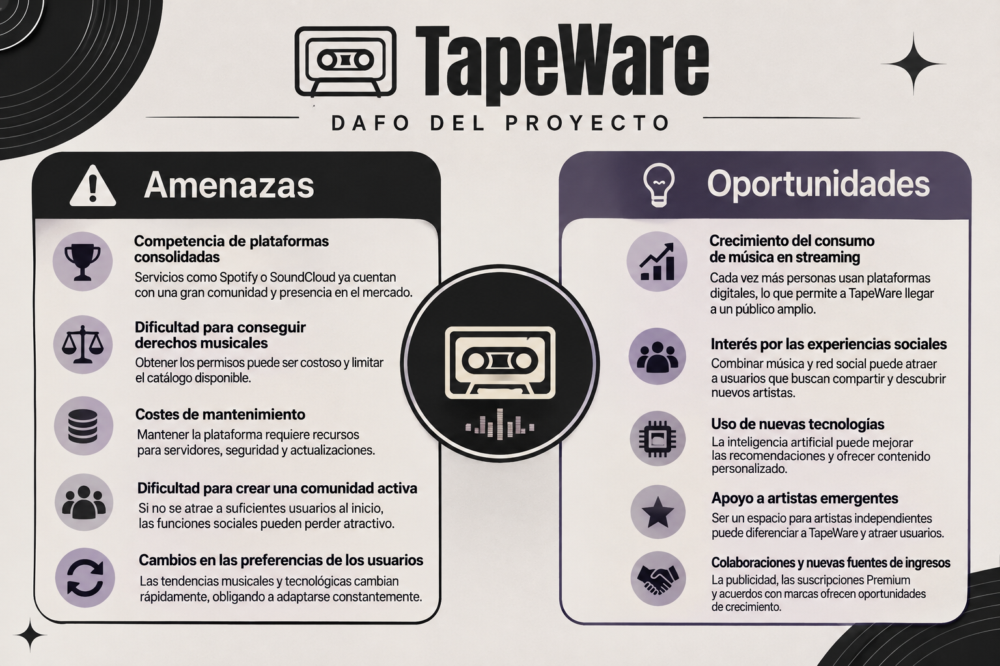

# GestionIssues

🎵 TapeWare
La red social donde la música conecta personas

TapeWare es una innovadora plataforma digital que combina el streaming musical con las funcionalidades de una red social. Su finalidad es ofrecer una experiencia más completa a los amantes de la música, permitiéndoles escuchar canciones, descubrir nuevos artistas, compartir contenido e interactuar con otros usuarios dentro de una misma comunidad.

🚀 Problema que Resuelve

Las plataformas musicales tradicionales están enfocadas principalmente en la reproducción de contenido, limitando la interacción entre usuarios y reduciendo la visibilidad de artistas emergentes. Por otro lado, las redes sociales no están diseñadas específicamente para el descubrimiento y disfrute de la música.

TapeWare nace para unir ambos mundos, creando un espacio donde la música y la interacción social conviven de forma natural. Los usuarios pueden compartir sus gustos musicales, comunicarse con otros miembros de la comunidad y ayudar a dar visibilidad a nuevos talentos.

🎯 Objetivos del Proyecto
Crear una comunidad musical activa y participativa.
Facilitar el descubrimiento de nuevos artistas y tendencias musicales.
Fomentar la interacción entre usuarios mediante herramientas sociales integradas.
Ofrecer a los artistas una plataforma para promocionar su música y conectar con su audiencia.
Proporcionar una experiencia innovadora que vaya más allá del simple streaming musical.
👥 Usuarios Destinatarios
🎧 Oyentes y Amantes de la Música

Personas que desean escuchar música, crear playlists, compartir canciones y descubrir nuevos artistas dentro de una comunidad con intereses similares.

🎤 Artistas y Creadores de Contenido

Músicos que buscan publicar sus canciones, aumentar su visibilidad, conseguir seguidores e interactuar directamente con sus fans.

📢 Empresas y Anunciantes

Marcas interesadas en promocionar productos y servicios a través de campañas publicitarias dirigidas a una comunidad musical activa.

⭐ Funcionalidades Principales
🎵 Reproducción de música en streaming.
📂 Creación y gestión de playlists personalizadas.
🤝 Playlists colaborativas entre usuarios.
💬 Chat privado para la comunicación entre miembros de la comunidad.
📤 Compartir canciones y playlists favoritas.
🎧 Descarga de canciones para escucharlas sin conexión.
🔍 Descubrimiento de nuevos artistas y tendencias musicales.
🌟 Promoción y apoyo a artistas emergentes.
👥 Seguimiento e interacción entre usuarios y creadores.
💡 ¿Qué hace diferente a TapeWare?

A diferencia de plataformas como Spotify, TapeWare no se limita únicamente al streaming musical. La aplicación incorpora características sociales como chats, playlists colaborativas y una mayor visibilidad para artistas emergentes, convirtiéndose en un punto de encuentro donde los usuarios pueden escuchar, compartir, descubrir y conectar a través de la música.

🎶 Eslogan

Escucha. Comparte. Descubre. Conecta.

- DAFO

